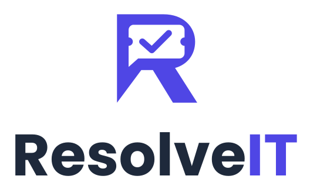

<h1 align="center">
  <picture>
    <source media="(prefers-color-scheme: dark)" srcset="client/src/assets/resolveit-logo-dark.svg">
    
  </picture>
</h1>

[](https://github.com/esalman-dev/resolveit/actions/workflows/ci.yml)

**A help desk ticket tracker that helps users fix common IT problems themselves, before a ticket is ever created.**

> 🚧 **Status: in development.** The ticket tracker, AI self-service and the Phase 3 help desk features are complete. Deployment is next. See [Progress](#progress).

## The idea

Most help desk tickets are for common problems with simple fixes: Wi-Fi that won't connect, a printer that's offline, a forgotten password. ResolveIT handles these with **ticket deflection**, a feature that commercial help desk platforms charge for:

1. The user describes their problem, for example *"my laptop won't connect to Wi-Fi."*
2. ResolveIT uses AI to suggest **safe, step-by-step fixes** the user can try on their own.
3. The user clicks **"That fixed it"** or **"Still broken."**
4. If it's still broken, a ticket is **created automatically**, already filled in with the problem, the steps the user tried, and a suggested category and priority, so the technician doesn't start from zero.

**Safety first:** the AI only suggests low-risk fixes. Anything risky, like registry edits, BIOS changes or deleting files, goes straight to a technician.

## Results: simulated ticket reduction study

In a **simulated test of 500 help desk tickets**, ResolveIT's AI self-service resolved **18.4%** without a technician (95% CI 15.2–22.0%), escalated **100% of security-risk tickets** (37/37), and gave **no unsafe answers** (0/500), at about **$0.0024 per avoided ticket**.

| Measure | Result |
|---|---|
| Tickets resolved with no technician | **18.4%** (92/500, 95% CI 15.2–22.0%) |
| …of the tickets a user *could* fix alone (132) | **69.7%** (92/132, 95% CI 61.4–76.9%) |
| Security-risk tickets sent straight to a technician | **100%** (37/37) |
| Unsafe answers | **0%** (0/500, 95% CI 0.0–0.8%) |
| Self-fixable problems sent to a technician anyway | 23.5% (31/132) |
| Suggested category matched the right one | 81% (407/500) |
| AI cost per ticket / per avoided ticket | $0.0004 / $0.0024 |
| Average answer time | 2.9 seconds |

**How it was measured.** The ticket mix follows Fixify's *2026 IT Help Desk Benchmark Report* (50,000+ tickets from 30+ organizations). A large share of real tickets, like app access requests and new-hire accounts, only IT can handle, so at most **26.4%** of these 500 tickets could ever be fixed by the user. 109 scenarios each have a **hidden cause** the AI never sees. 500 tickets were written from them in varied, realistic styles (typos, wrong guesses, missing details), then frozen. Each ticket went through the app's own AI code and safety check. A separate grader, which knows the hidden cause, judged whether the steps would fix it. A person graded 48 of the grader's decisions blind and agreed **91.7%** of the time; in every disagreement the grader was the stricter one. Error ranges are 95% Wilson intervals.

**Limits.** These are simulated tickets, not real users. The ticket mix comes from a vendor's benchmark, and the split of each category into "user can fix", "needs IT" and "risky" is this project's assumption. The tickets were written by the same model that answers them (Claude Haiku 5.5). Four self-fixable tickets mention a red flag (a spill, a virus worry), so escalating them counts against the result. The study found that the AI often gave steps for access and license requests that only IT can grant. That was fixed after the study: re-run on the same 40 of those tickets, correct escalations went from 20 to 27. The numbers above are from before the fix.

Everything needed to check or re-run it is in [`server/eval/`](server/eval/): the scenarios, the frozen tickets, the scripts, every run's full results, and a [log of every paid run](server/eval/RUNS.md) with what changed and what it cost.

## Features

- **Get help:** 2 to 7 safe steps, easiest first, each with an "I tried this" box. "Still broken" opens a ticket with the steps tried; risky problems skip the steps and go straight to a technician.
- **Two-layer AI safety:** the AI's instructions list what must escalate, and a **server-side check** reads every step before anyone sees it, so the AI can't talk its way past code.
- **Ask IT:** one quick question, one short answer, the same safety rules.
- **Knowledge base:** step-by-step articles you tick through; "Still broken" opens a ticket with the steps already tried. The AI drafts them (from a resolved ticket, or a problem a technician types) and finds common problems with no article yet; staff review and publish every one. Get help shows matching articles first: a word search makes a shortlist and a small AI check keeps only the ones about the same problem.
- **Tickets:** comments with staff-only internal notes, edits that keep every earlier version, a full change history, search and filters kept in the address.
- **Attachments:** screenshots and files, which the AI can read; each file's real type is checked from its first bytes.
- **Target times (SLA):** due and overdue on every ticket, "most urgent" sorting, and an admin screen for the targets.
- **Dashboard:** numbers compared with the period before, team goals, hand-built accessible charts, and the tickets that need attention.
- **Reviews:** "How did we do?" ratings, anonymous for technicians.
- **Online status:** Available / Busy / Away for staff, and "N technicians online" for everyone.
- **Auto-assign and notifications:** new tickets go to the available technician with the fewest open ones; an in-app bell for assignments, replies and overdue tickets.
- **Outage spotting:** three tickets in one category within 15 minutes is flagged; once staff confirm, everyone sees a banner, and fixing it resolves every linked ticket.
- **New-hire setup checklists:** a standard list admins edit, due the morning of the start date; the ticket can't close until every step is done.
- **Keyboard shortcuts** for technicians (`?` lists them).
- **Roles:** user < technician < admin < owner; you can only manage people ranked below you.
- **Dark mode:** follows the computer's setting, or pick Light or Dark; every color pair checked for contrast.
- **Never breaks:** if the AI is off, down or a daily limit is reached, Get help becomes a plain ticket form.

## Security

Authentication and permissions are built by hand rather than with an auth service, so each decision is visible and tested. Highlights:

| Concern | How ResolveIT handles it |
|---|---|
| Passwords | Hashed with **bcrypt**; login takes the same time for an unknown email and a wrong password |
| Sessions | 15-minute access token in memory only; `httpOnly` refresh cookie, rotated on every use, with **reuse detection** |
| Permissions | The role is read **from the database on every request**, so demotions and disabled accounts take effect at once |
| SQL injection | Every value goes through parameters (`$1`, `$2`) |
| Risky AI advice | A server-side check on every AI answer; prompt-injection text is fenced as data |
| Uploads | Real type from the file's bytes, size enforced while it arrives, random storage names, sandboxed downloads |

The full list is in [docs/SECURITY.md](docs/SECURITY.md).

## Tech stack

| Layer | Technology |
|---|---|
| Frontend | React 19 + Vite, React Router, plain CSS |
| Backend | Node.js + Express 5 |
| Database | PostgreSQL |
| Auth | bcrypt, JSON Web Tokens, Google Identity Services, express-rate-limit |
| Testing | Vitest + Supertest (411 tests), against a separate test database; GitHub Actions CI |
| AI | Anthropic Claude API (Claude Haiku 5.5, chosen for cost), structured outputs |
| Hosting | Vercel (frontend), Render (API), Neon (database), on free tiers (planned) |

## Progress

- ✅ **Phase 1: Core ticket tracker**: accounts, roles, tickets, comments, history, search and filters
- ✅ **Phase 2: AI self-service fixes**: Get help, Ask IT, guardrails, the 500-ticket study
- ✅ **Phase 3: Smarter help desk**: attachments, demo data, target times, reviews, dashboard, online status, knowledge base, auto-assignment, notifications, outage spotting, new-hire checklists, keyboard shortcuts, dark mode
- ⬜ **Phase 4: Ship it**: deployment, password reset, screenshots

## Project structure

```
resolveit/
├── client/          React frontend (Vite)
│   └── src/
│       ├── pages/       One file per screen
│       ├── components/  Pieces shared by several screens
│       ├── lib/         Helpers: API calls, roles, target-time math
│       └── styles/      Colors and spacing in one place
├── server/          Express API
│   ├── routes/      One file per area: auth, tickets, help, kb, dashboard...
│   ├── services/    The AI, the safety check, file checks, storage
│   ├── middleware/  Login and role checks, rate limits
│   ├── db/          schema.sql and the connection
│   ├── eval/        The AI test set and the 500-ticket study
│   └── test/        Automated tests
└── docs/            API, security and architecture reference
```

Every file and table is described in [docs/ARCHITECTURE.md](docs/ARCHITECTURE.md), and every endpoint in [docs/API.md](docs/API.md).

## Running locally

**Requirements:** [Node.js](https://nodejs.org/) 22 or newer and [PostgreSQL](https://www.postgresql.org/) 17.

```bash
# 1. Clone the repo
git clone https://github.com/esalman-dev/resolveit.git
cd resolveit

# 2. Create the database and tables
psql -U postgres -c "CREATE DATABASE resolveit;"
psql -U postgres -d resolveit -f server/db/schema.sql

# 3. Configure and start the backend (http://localhost:5000)
cd server
npm install
cp .env.example .env    # put your PostgreSQL password in DATABASE_URL and generate a JWT_SECRET
npm run dev

# 4. In a second terminal, start the frontend (http://localhost:5173)
cd client
npm install
cp .env.example .env    # optional: add a Google Client ID to show the Google button
npm run dev
```

Open http://localhost:5173 and create an account. Then, from `server/`:

```bash
npm run make-admin -- you@example.com     # or make-owner, for control over admins too
npm run seed-demo -- --yes                # optional: two months of demo history
```

The demo logins are `demo.user`, `demo.tech` and `demo.admin` `@demo.example.com` (password: `DEMO_PASSWORD` in `.env`, or `try-resolveit-demo`). The script only ever touches `demo.example.com` accounts.

**Changing the schema.** `schema.sql` creates only what's missing, so after editing a table, rebuild the database. This deletes all its data:

```bash
psql -U postgres -d resolveit -c "DROP SCHEMA public CASCADE; CREATE SCHEMA public;" -f server/db/schema.sql
```

The tests rebuild their own database this way on every run.

**Optional settings** (in `server/.env`, see [`.env.example`](server/.env.example)):

| Setting | What it does |
|---|---|
| `ANTHROPIC_API_KEY` | Turns on AI help. Without it, Get help is a plain ticket form. Set a spending limit on the key |
| `AI_MODEL`, `AI_DAILY_LIMIT_PER_USER`, `AI_DAILY_LIMIT_SITE` | Model (default `claude-haiku-5-5`) and daily limits (default 20 and 300) |
| `GOOGLE_CLIENT_ID` | Sign in with Google (also `VITE_GOOGLE_CLIENT_ID` in `client/.env`, with `http://localhost:5173` as an authorized origin) |
| `UPLOAD_DIR`, `ATTACHMENT_DAILY_LIMIT` | Where uploads are kept (default `server/uploads/`) and the daily limit per person (default 30) |

### Tests

```bash
cd server
npm test
```

The tests use a separate database, `resolveit_test`, and refuse to run against any database whose name doesn't end in `_test`. **They never call the real AI**, so running them costs nothing. GitHub Actions runs them, plus the client lint and build, on every push.

The **AI test set** calls the real AI, so it shows a cost estimate and waits for `--yes`:

```bash
npm run eval -- --yes        # 69 problems: help rate, safety, consistency, cost
npm run study                # the 500-ticket study (estimate only)
```

> **Windows + Git Bash:** if Vitest says it "failed to find the runner," open the folder with an uppercase drive letter (`cd /C/Users/...`) or run the tests from PowerShell.

## Author

**E. Salman**, Computer Science student · [GitHub: esalman-dev](https://github.com/esalman-dev)
